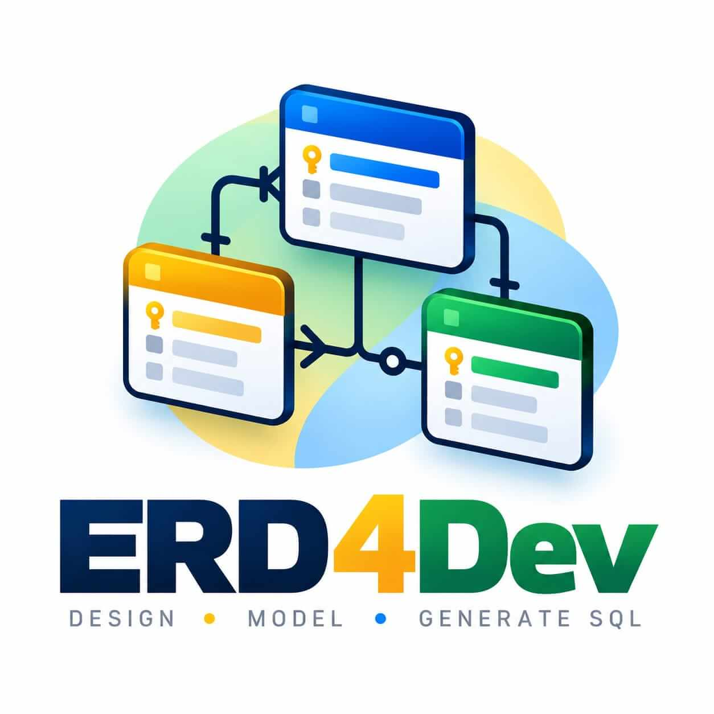

<p align="center">
  <a href="https://github.com/makermindclub/erd4dev">
    
  </a>
</p>

# ERD4Dev

[](https://packagist.org/packages/makermind/erd4dev)
[](https://packagist.org/packages/makermind/erd4dev)
[](https://www.php.net/)
[](https://laravel.com/)
[](https://livewire.laravel.com/)
[](https://github.com/makermindclub/erd4dev/blob/main/LICENSE)

Visual database modeling for [Laravel](https://laravel.com/), built with [Livewire](https://livewire.laravel.com/). Design entity-relationship diagrams, convert them into relational models, and export SQL or Laravel Blueprint drafts directly from your application.

Maintained by [Makermind](https://github.com/makermindclub).

[Installation](#installation) · [Access control](#access-through-the-application-server) · [Modeling and importing](#modeling-and-importing) · [Blueprint drafts](#blueprint-drafts)

## Features

- Design ER diagrams and generate linked relational models.
- Import and export diagram JSON, import SQL, or read the current database connection schema metadata.
- Edit tables, columns, keys and relationships on a visual canvas.
- Export SQL, diagram images and drafts for [Laravel Blueprint](https://github.com/laravel-shift/blueprint).

## Requirements

| Dependency | Version |
| --- | --- |
| PHP | 8.3+ |
| Laravel | 12+ |
| Livewire | 4.3+ |

Composer package: `makermind/erd4dev`. PHP namespace: `Makermind\Erd4dev`.

## Installation

Install from [Packagist](https://packagist.org/packages/makermind/erd4dev) in your Laravel application. ERD4Dev requires WireFlow exactly at its published version `0.2.4-alpha`:

```bash
composer require --dev makermind/erd4dev:@dev
```

The `@dev` constraint is intended for development versions of ERD4Dev. When installing a stable release, use the appropriate stable package constraint.

If your application does not allow alpha dependencies, explicitly allow WireFlow with `composer require getartisanflow/wireflow:0.2.4-alpha makermind/erd4dev:@dev -W`. Replace any existing `^0.1.2@alpha` requirement in the application; it conflicts with `0.2.4-alpha`.

Open `/erd` at the address and port already used by your application (for example, `http://localhost:8000/erd`). The package is discovered by Laravel automatically. No additional server, restart, Vite, asset publication or installation command is needed for normal local use.

`erd:install` remains an optional command to publish compiled assets and the package migration. Its `--migrate` flag runs **all pending application migrations**. Outside the local environment, publish and run the migration explicitly. Existing route caches must be regenerated after installing a package; persistent application workers need to load the new code as usual.

## Access through the application server

ERD4Dev has no user accounts or per-user diagram ownership. Outside the `local` environment, its middleware requires the host application to authorize the `erd.access` Laravel Gate before allowing access to the editor, including Livewire updates. This is an access check for the entire shared workspace; it does not provide user management. Local development does not require configuring this Gate.

To publish the optional package configuration:

```bash
php artisan vendor:publish --tag=erd-config
```

Configuration controls the domain, middleware and storage table. The `/erd` prefix is fixed to avoid occupying the application root or its other routes. Routes use `erd.` names and views use `erd::`. The default storage table is `erd_diagrams`. Diagrams form a shared workspace without per-user or tenant isolation.

## Modeling and importing

JSON import automatically detects ER diagrams and relational models exported by the editor, preserving their structure and opening the appropriate board. Invalid references are rejected before creating a project. JSON files are limited to 2 MB.

Start with an ER model and generate a linked relational model, or import SQL/database metadata directly into an independent editable relational board. Structural changes to linked models belong in the ER source.

SQL is parsed as text and never executed. Database import reads schema metadata from connections configured in `config/database.php`. Supported Laravel native drivers (SQLite, MySQL/MariaDB, PostgreSQL and SQL Server). Only SQLite has been tested against a real database.

Snapshots contain tables, columns, primary/unique keys and foreign keys. Data, defaults, checks, views, routines, ordinary indexes, collations and referential actions are outside the diagram representation. Unsupported structures are reported. Editing a snapshot changes only the saved diagram, never the source tables or records. Diagram records themselves use the host application's configured storage database.

On imported boards, **New table** creates a table with an id primary key. Rename tables and columns, add/remove columns, and set PK/UNIQUE keys directly on the canvas. Column types, sizes, enums and nullability are editable in their rows. Enum values retain embedded commas, spaces, empty strings and zero values.

**Relationships** links FK columns, including composite and recursive references. Cardinality follows uniqueness and nullability: a unique source key produces 1:1, otherwise N:1; nullable columns allow optional references. Changes that invalidate referenced keys are rejected.

The header places the database selector on the left, model tabs in the center and actions on the right. New table and Relationships are adjacent. Smaller screens keep a single toolbar row and expose secondary actions through **More**. SQL, Blueprint draft and image exports are in More on all screen sizes.

Public ER examples include only features configurable in the current interface. Readers retain compatibility with legacy diagrams and previously generated SQL headers. Existing user-authored names and saved diagram contents are not translated automatically.

## Blueprint drafts

Choose **More → Generate Blueprint draft**. Each click saves a new file in the consumer project's root:

```text
blueprints/draft-{diagram-id}-{YYYYMMDD}-{HHMMSSmicroseconds}.yaml
```

Exclusive file creation prevents overwrites; collisions receive a suffix. Commit the `blueprints/` directory to version control. Drafts contain the current saved board without credentials or database records.

The result appears in a dismissible dialog with collapsed warnings and a copyable command. Reopen it through **More → Last draft** without generating another file. After review:

```bash
php artisan blueprint:build blueprints/draft-42-20261103-123456123456.yaml --only=models,migrations
```

The Blueprint package is included. Generating a draft only writes YAML. It does not automatically generate PHP files or run migrations. Database configuration, review and migration execution remain the user's responsibility. Drafts describe full schemas, not migration diffs against existing tables.

Actual table names are preserved in `meta.table`. Missing id/timestamp columns are not implicitly added. Composite PK/UNIQUE keys are represented as indexes. Composite FKs and cross-schema references retain their columns but omit constraints that Blueprint cannot faithfully represent, with explicit warnings. Composite or nonstandard primary keys require reviewing the Eloquent model.

Reserved Blueprint names, incompatible identifiers, unsupported custom types and unrepresentable enums block draft generation with an explanation; partial drafts are not saved.

## Development

Run package integration tests from this repository root:

```bash
composer install
composer test
```

The package's development configuration accepts alpha dependencies and prefers stable versions. Consuming applications must still explicitly accept the WireFlow alpha release as shown above; dependency stability settings are not inherited.

Include the compiled `dist/erd.js` and `dist/erd.css` in releases; consumers do not need Node.js or a frontend build.

## Support and contributions

Report bugs and request features through [GitHub Issues](https://github.com/makermindclub/erd4dev/issues). Include your PHP, Laravel and Livewire versions and steps to reproduce the problem. Pull requests are welcome; run the integration tests before submitting changes.

## License

ERD4Dev is distributed under the [MIT license](https://github.com/makermindclub/erd4dev/blob/main/LICENSE). Third-party license notices are available in [`licenses/`](https://github.com/makermindclub/erd4dev/tree/main/licenses).
