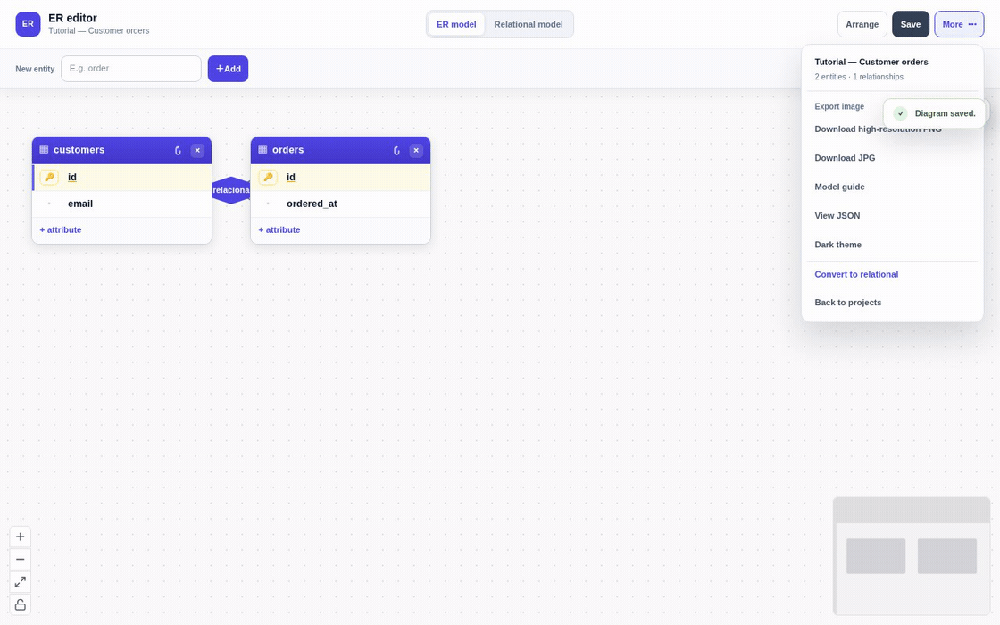
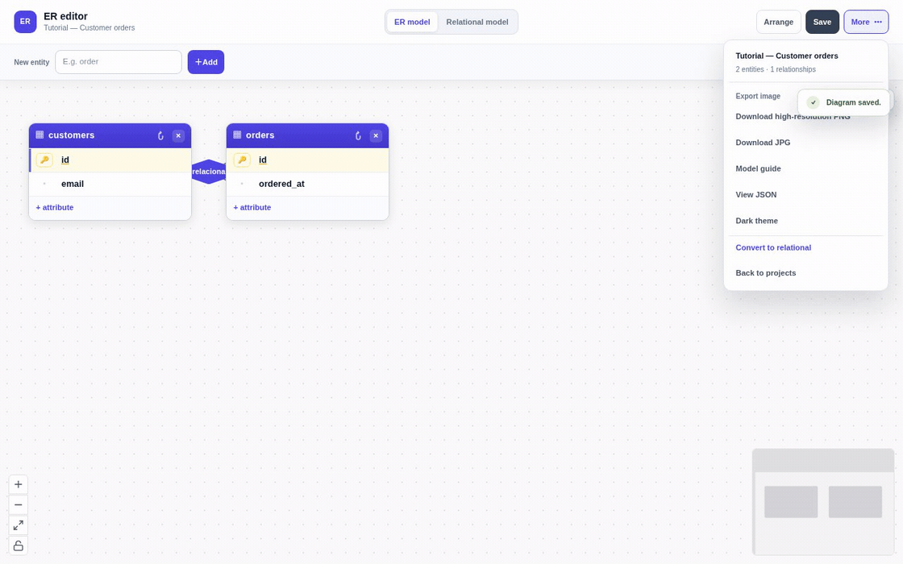
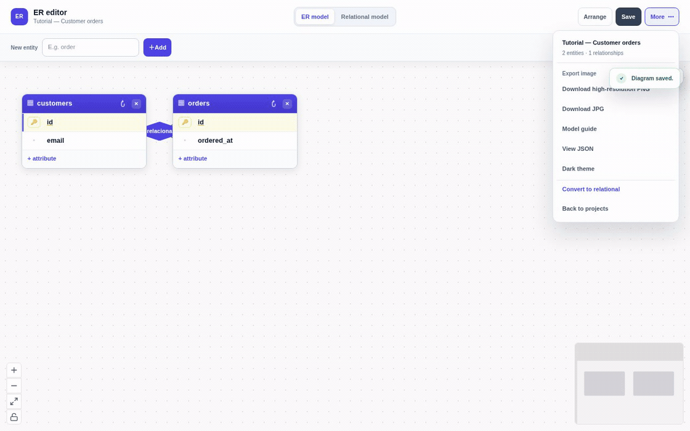

# ER editor: More menu

**More** groups export, help, presentation, and navigation actions. This is the actual package menu, not the interactive landing-page demo. Options can move between the toolbar and menu as the available width changes.

## Model guide, View JSON, and theme

**Model guide** opens the inline explanation of ER modeling, shortcuts, and cardinality. Close it with its close button. It does not change the diagram.

**View JSON** opens the saved model representation in a dialog. Inspect entities and relationship references, use **Copy**, or download a .json file. JSON is the editable interchange format; an image export is a visual reference.

**Dark theme / Light theme** switches the package interface. Theme changes affect presentation, not keys, cardinality, or generated schema.

## Download high-resolution PNG and Download JPG

**Download high-resolution PNG** produces an image of the board for documentation or printing. **Download JPG** provides a second image format for sharing. These exports do not contain an editable project or replace a JSON backup.

The recording triggers both image downloads, then opens **View JSON** and downloads .json. Browser download behavior depends on the visitor's settings; downloaded files are not changes to the database.

## Arrange and Save

**Arrange** reorganizes the positions of diagram elements. **Save** persists the current diagram, with a confirmation notice. On wide screens these actions are on the toolbar; compact layouts expose the corresponding menu actions. Ctrl/Cmd+S also saves.

## Convert to relational and Open relational model

Before a linked model exists, **Convert to relational** creates it from the ER structure. After creation, **Open relational model** opens that board. If the ER source has changed, the interface flags the linked model as outdated; opening it alone does not authorize replacing its edits.

Use **Regenerate from ER** on the relational board when you have reviewed the changes. See [Review the model](review.md).

## Back to projects

**Back to projects** returns to the dashboard to open, import, or create another project. Save your intended edits before leaving the editor.

## Canvas controls outside More

**Background** changes the canvas pattern among dots, solid, grid, and crosses. Zoom, fit-to-view, the minimap, and the interaction lock help navigate large boards. These controls affect the view; they do not replace structure editing or saving.
