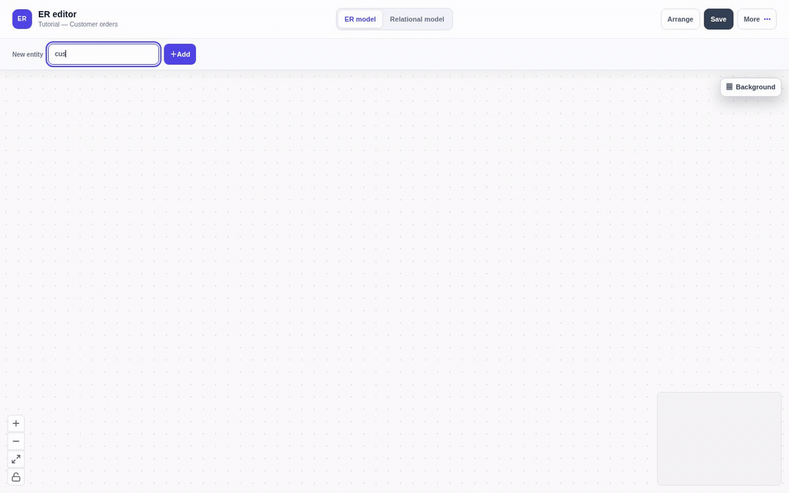
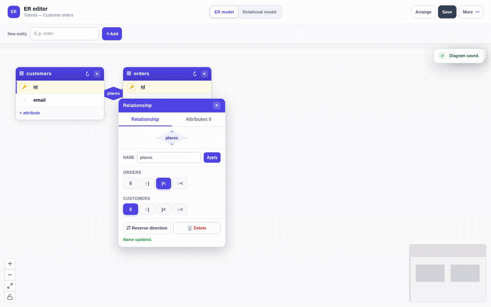
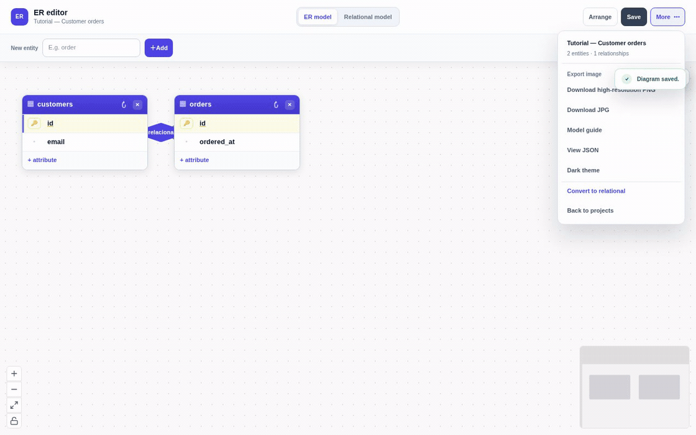
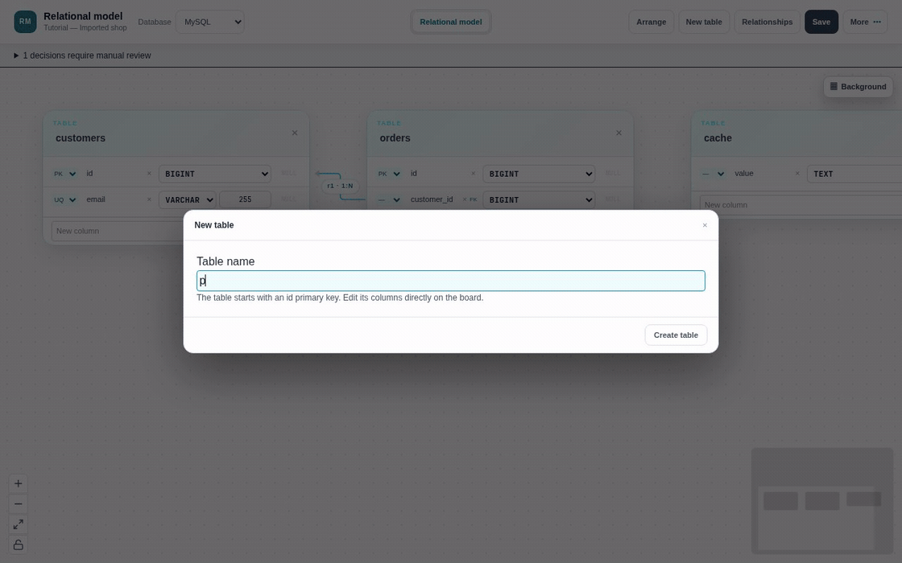

# Recorded walkthroughs

These GIFs are recordings of the running ERD4Dev package inside a Laravel application. They show the actual ER and relational editors, menus, notices, and dialogs. Each clip focuses on one task; click an image to open it at full size.

## Create entities and attributes

Enter a name under **New entity** and click **Add**. Each entity starts with an id primary key. Open **+ attribute**, enter a name, and confirm with Enter. Use **Arrange** to organize the canvas and **Save** to persist the diagram.

Click an entity name to rename it. Attribute names are editable on their rows; the key button cycles between no key, PK, and UQ. Removing a referenced key can affect its relationships, so inspect connections after structural edits.

## Connect entities and edit relationships

Hold Alt and drag from one entity to another to connect them. The referenced entity needs a primary or unique key. Click the connecting line or relationship label to open its editor. Set the name and cardinality at both ends; the **Attributes** tab adds facts about the association itself.

The recording renames a relationship to places, selects zero-or-many participation, and adds a relationship attribute. That attribute describes each association occurrence, rather than every instance of one entity.

The editor also offers **Reverse direction**. For a self-relationship, it offers role names and **Swap roles** instead. Use the entity header's circular arrow to create a self-relationship. Review [Relationship patterns](relationships.md) for the meaning of those structures.

## Convert ER into a relational model

Use the **Relational model** tab or **More → Convert to relational**. ERD4Dev creates a linked relational board. Inspect the resulting tables and foreign keys; **More → Model guide** summarizes the transformation rules.

Existing linked boards use the label **Open relational model**. Opening the board and regenerating it are separate actions. See [Linked models and regeneration](regeneration.md) before replacing manual adjustments.

## Edit an independent relational board

This example starts from an SQL import. **New table** creates payments with an id key. Add order_id on the table, choose its BIGINT type, then open **Relationships**. Select the source table and column, the referenced table and key, and click **Add relationship**.

Table and column names are editable directly on independent boards. Type selectors, lengths, precision, scale, and NULL controls configure column definitions. For composite references, add one column pair for each component of the target key. Structural creation controls are conditional: linked ER boards keep their structural source in ER.

## Explore the hidden menu actions

The [ER More menu](er-menu.md) covers images, JSON, the model guide, theme, conversion, and navigation. The [Relational More menu](relational-menu.md) covers those shared actions plus SQL, Blueprint, Laravel table visibility, and regeneration.
