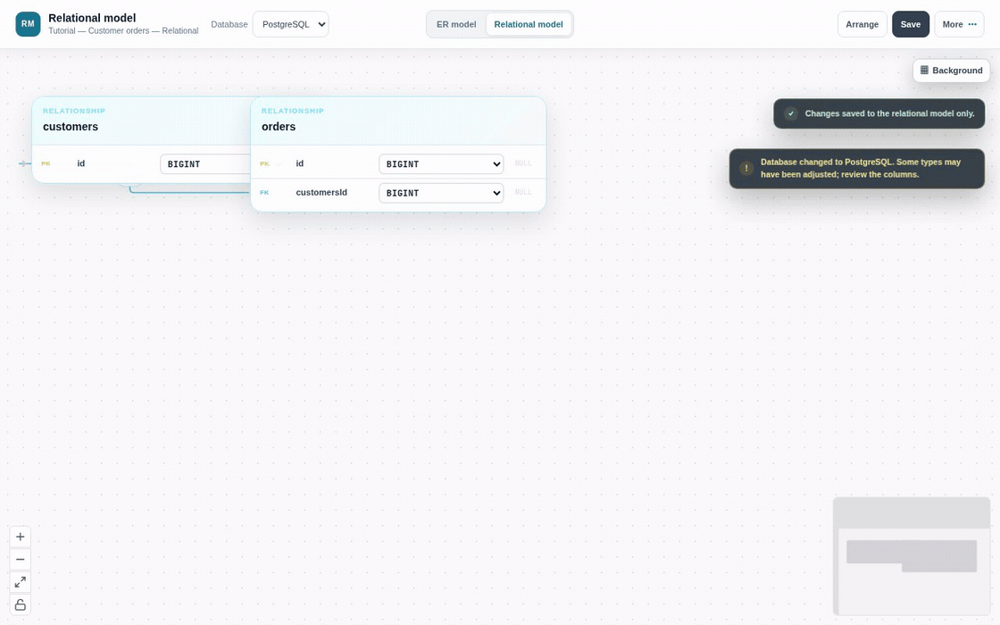
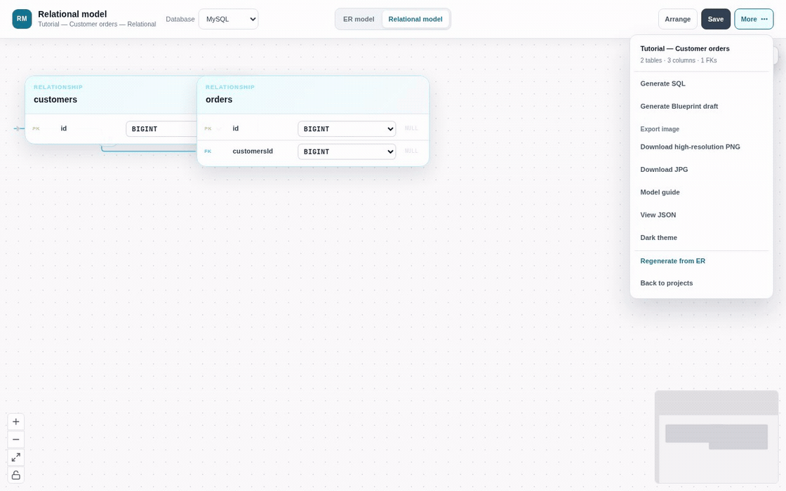
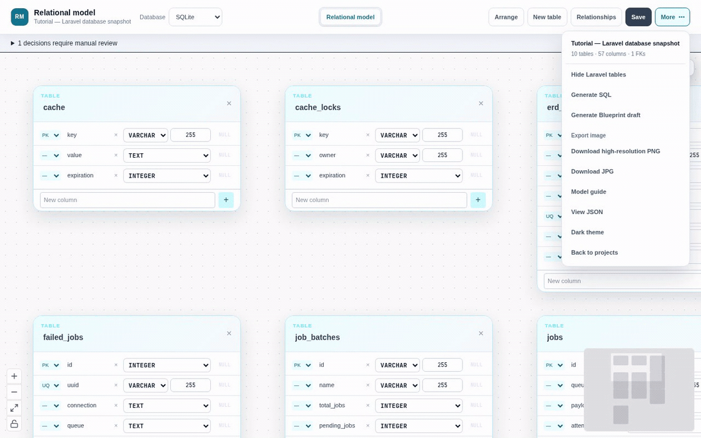
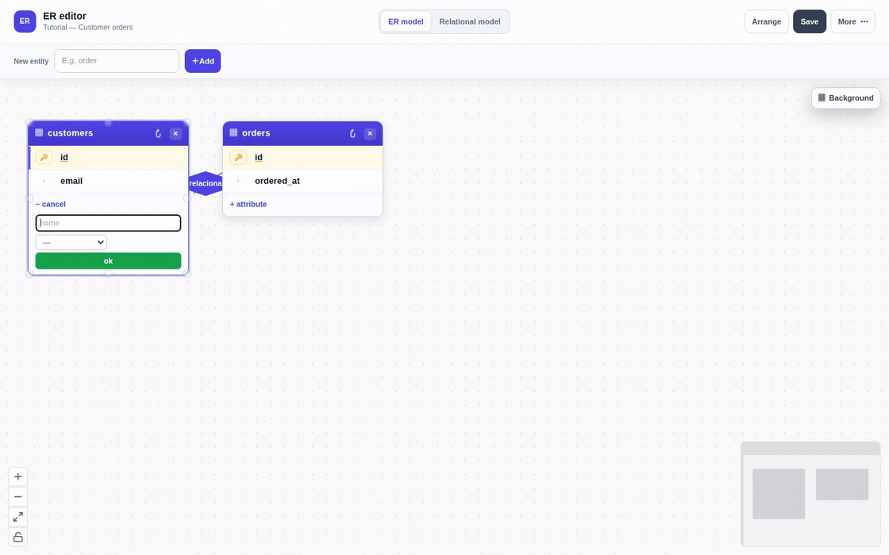
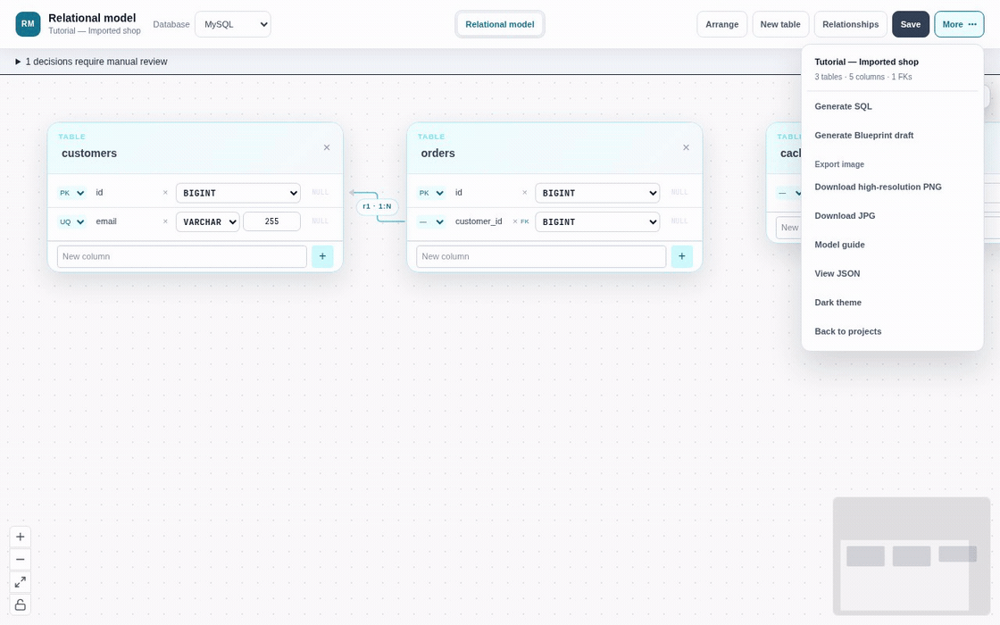

# Relational: More menu

The relational menu combines exports with actions that depend on the board's origin. A board generated from ER has a source and can be regenerated. An independent imported board exposes table and relationship creation. Database-origin snapshots can also expose Laravel table visibility.

## Generate SQL and the target database

Choose the target engine in **Database**, then use **More → Generate SQL**. The dialog shows the generated definitions and offers **Copy** and **Download .sql**. In this recording, the target is changed to PostgreSQL before reviewing and downloading SQL.

**View JSON** opens the corresponding relational representation, with tables and foreignKeys rather than ER entities and relations.

Changing the target dialect changes type handling and output syntax. It does not migrate a running database. Generated SQL is a schema representation, not an automatic diff against existing tables. Read [Review SQL output](sql-output.md).

## Generate Blueprint draft and Last draft

**Generate Blueprint draft** writes a new YAML draft under blueprints/ in the host application. The result dialog shows the actual path, any warnings, and the Blueprint build command. **Copy command** copies that command for later execution.

Close the dialog and use **Last draft** to reopen its result. This option is conditional: it appears after a draft result is available in the current editor state.

Draft creation does not run Blueprint or apply migrations. A new YAML file is protected from overwriting another draft; the later Blueprint build can overwrite existing PHP models. Review [Blueprint drafts](blueprint-drafts.md) before running the copied command.

## Hide Laravel tables and Show Laravel tables

On a database-origin snapshot with recognized framework tables, **Hide Laravel tables** hides those tables while preserving users. **Show Laravel tables** restores them. The recording imports the demo application's real SQLite schema with internal tables included, hides them, inspects SQL, and shows them again.

The preference affects the saved diagram and SQL/JSON output, not the source database. If tables were excluded during initial database import, showing them later cannot recreate omitted data; re-import with the import filter disabled. In this package version, the board visibility control depends on database-origin metadata and does not appear on ordinary SQL imports.

## Regenerate from ER

This action is available for a linked relational board. It rebuilds from its ER source and asks for confirmation because manual adjustments can be replaced.

The recording returns to ER, adds a phone attribute, saves, and reopens the linked relational board. It expands the pending-change report and uses **More → Regenerate from ER**. The updated model is then visible on the board.

Preserve important manual edits before regeneration. This updates the diagram, not live database tables. See [Linked models and regeneration](regeneration.md).

## Images, JSON, theme, Arrange, Save, and navigation

**Download high-resolution PNG** and **Download JPG** export the relational board as images. **View JSON** offers copy and .json download of its editable structure. **Dark theme / Light theme** switches presentation.

**Arrange** lays out the board; **Save** persists edits to the relational model. Both are toolbar actions on wide screens and may move into the menu on compact layouts. **Back to projects** returns to the dashboard.

## Model guide, New table, and Relationships

**Model guide** explains the board's workflow. Linked boards explain ER-to-relational conversion; independent imports explain direct column editing.

**New table** and **Relationships** are available on independent boards, with compact-layout menu counterparts. The first creates a table with an id primary key. The second manages foreign keys, names, and composite column pairs. Removing a relationship keeps its columns; removing a column or table can also remove dependent references.

Watch the independent-board example in [Recorded walkthroughs](recordings.md).
